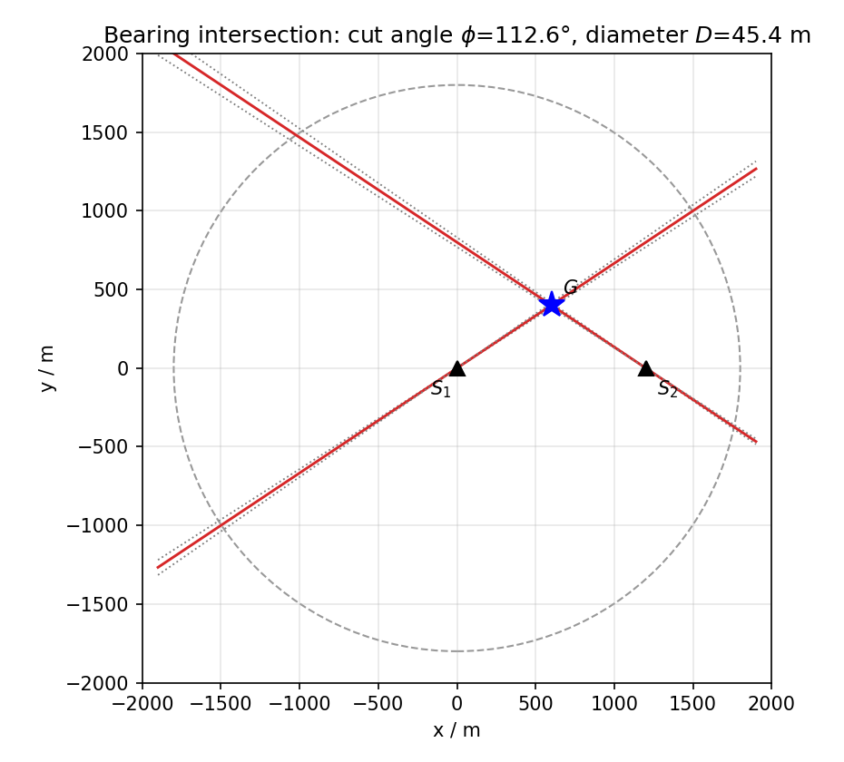
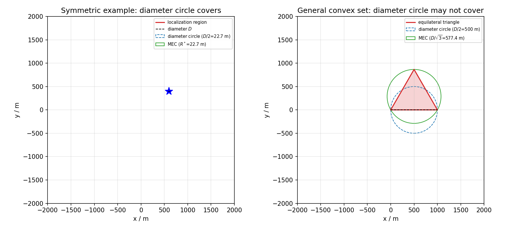
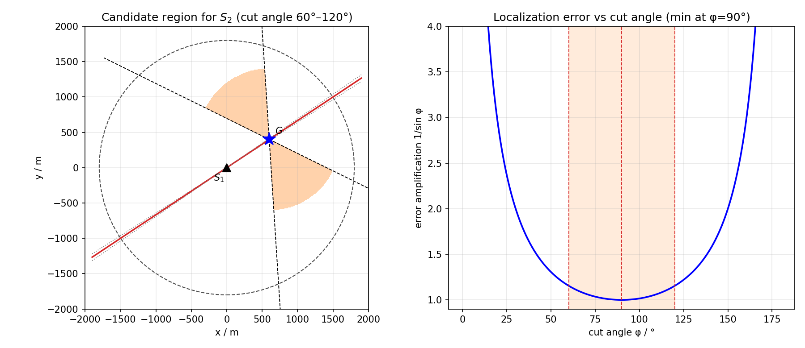
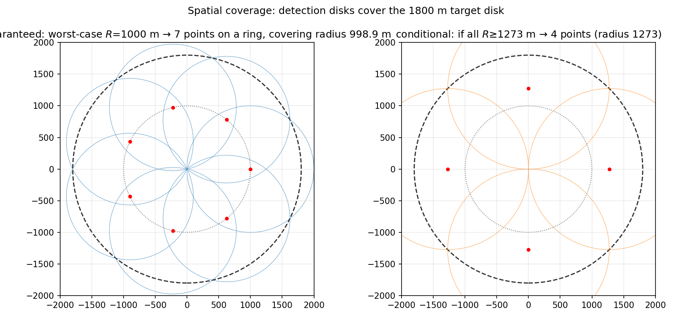
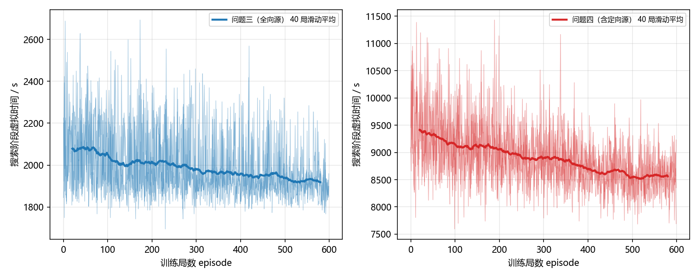
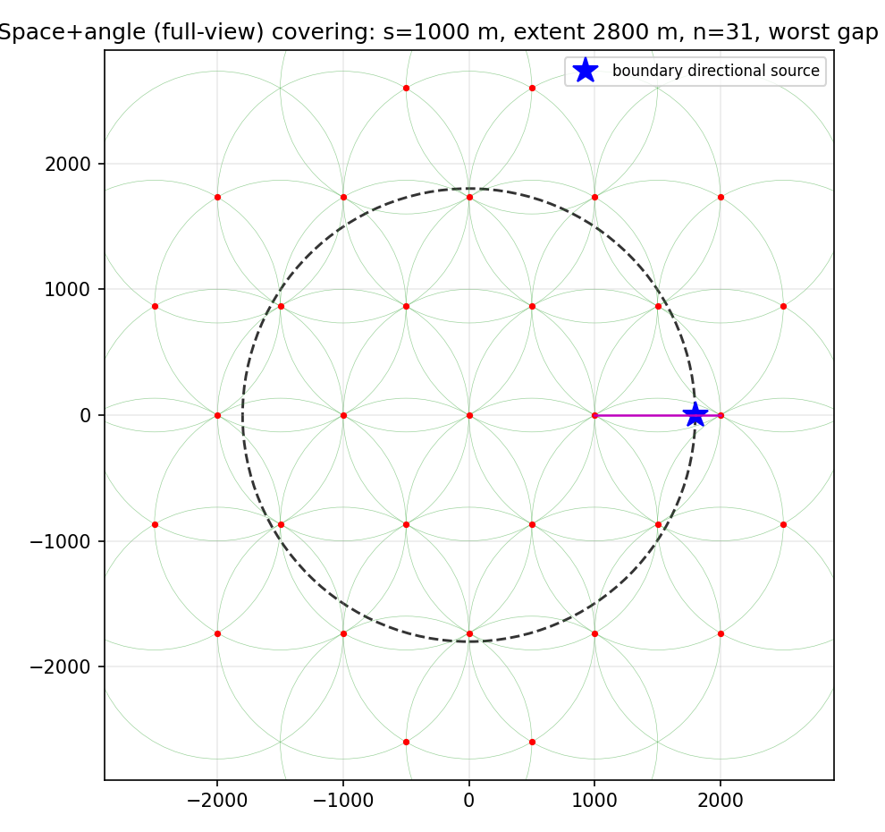

# 摘要

无线电干扰源定位是频谱管理的重要任务。本文以"**有界测向可行域—安全覆盖—约束强化学习—鲁棒清除**"为主线，研究机器狗在半径 1800 m 圆域内自动定位清除干扰源的问题。强化学习负责依据观测选择听点和补测时机，几何覆盖与动态规划分别作为安全约束和小规模路由先验。

**针对问题一**，把示向度区间化为两个半平面约束，对有界交会多边形用凸包与旋转卡壳求直径，并以最小包围圆或逐顶点检验回答覆盖问题；直径圆一般不能保证覆盖，双站对称算例只是可覆盖的特例。

**针对问题二**，在检测距离给定时由 Fisher 信息矩阵得到角度项在 90° 最优，并结合最坏接收半径给出 60°–120° 的稳健候选带和在线选点准则。

**针对问题三**，将搜索—定位—清除建模为带安全动作屏蔽的 POMDP，以稀疏表格 Q-learning 学习听点访问与补测策略。覆盖侧给出**7 点下界的构造性证明**（$r(6)=0.5559$ 需 $R\ge1000.6$ m），并在 7 点约束下以"最小化自原点开行程"为目标得到最优布局——半径 998.92 m 的**正七边形环**，覆盖半径证书 998.92 m $<R_{\min}=1000$ m、开行程 6199 m（原 13 点双环为 12362 m）。清除侧把实时听巡与清除**在线交织**（最廉插入、增量里程阈值 300 m），并以问题 1 的**交会定位区域**作为 28 m 网格的边界，使"遍历完必能清除"的保证依然成立而兜底代价下降一个数量级。独立 35 组离线测试全部清除，总时间 P10–P90 为 3400.6–4333.0 s，中位每源 **299.5 s**（较原方案 −33.5%）。

**针对问题四**，证明外推三角格每个基本三角形的三个顶点可形成全视角覆盖，构造 31 个强制听点；Q-learning 在训练阶段学习路由与补测收益，部署阶段沿经 Hamilton 三角格路径优化的安全证书路线访问全部强制点，清除阶段不再依赖持续信号。35 组混合源与 35 组全定向压力测试均全部清除，混合源每源时间中位数 **764.9 s**、全定向压力集 800.8 s。本文同时给出该证书下的**移动时间硬下界**：31 个两两距离不小于 1000 m 的点、开路径至少 30 段 $\Rightarrow\ge30.00$ km $\Rightarrow\ge6000$ s，故问题四的时间不可能像问题三那样大幅压缩。`input/log.md` 当前含四次问题三**演练**记录（源数加权每源 306.6 s/个，全部清除）与一次问题四演练记录（842.3 s/个）；均不足题目要求的正式测试三次，正式测试完成后必须替换并补齐。

**关键词：** 交会定位 极坐标 圆盘覆盖 全视角覆盖 强化学习 Q-learning 机器狗

# 1 问题重述

## 1.1 问题背景

无线电干扰源通常分"初步监测、区域性排查、精准定位"三阶段清除。在精准定位阶段，技术人员携带测向机徒步排查，通过场强变化与方向特征逐步逼近干扰源。为在危险环境中提高效率，某公司拟研发搭载于机器狗的干扰源自动定位清除系统：机器狗在目标区域内移动、在检测点测量干扰源的示向度（方位角），交会定位后以光学探测仪精确定位并用激光枪清除。

目标区域是半径 1800 m 的圆形区域，圆域中心为坐标原点，正东为 $x$ 轴正向，正北为 $y$ 轴正向。区域内干扰源个数未知。干扰源频道互异、位于 20 个频道中；按覆盖角分为全向源（360°）与定向源（180°，方向未知）；场强仅随距离衰减；有效接收半径在 1000–1500 m 之间；示向度测量误差在 ±1° 内。

## 1.2 四个问题

**问题一：** 已知若干检测点坐标及某干扰源关于这些检测点的示向度，给出交会定位法计算多边形定位区域直径的算法，并回答以定位区域直径为直径的圆能否覆盖该区域。

**问题二：** 已知某全向源在一个检测点的示向度，给出第二个检测点的选择策略与候选区域。

**问题三：** 目标区域全为全向源、总数 10–16 个（未知），机器狗从原点、频道 1 出发，制定在保证全部清除前提下总时间最短的自动搜索定位清除策略与算法，并通过模拟器演练与三次正式测试检验。

**问题四：** 目标区域同时含全向源与定向源（定向源个数、方向均未知），其余同问题三，给出检测清除策略与算法并通过模拟器测试。

# 2 问题分析

四个问题共享一条主线：**先刻画单个源的位置可行域，再用覆盖理论构造不可跳过的安全动作，最后由强化学习在安全动作集内优化多源搜索—定位—清除的序贯决策**。

## 2.1 问题一的分析：源位置可行域

示向度是测向机在检测点测得的"指向干扰源的最大场强方向"的方位角，本质是一个**极角**；示向度存在 ±1° 误差，故每个检测点把源限制在一个"楔形"（两个半平面之交）内。多个楔形相交得到题目所称的**交会定位多边形**；两检测点在非退化情形下一般得到凸四边形，但并不必然是平行四边形。求其直径是凸多边形直径问题，"直径圆能否覆盖"则是最小包围圆或逐顶点检验问题。纯楔形交在测向线近平行时可能无界，此时应增加检测点；若叠加目标圆域或接收圆盘作业务截断，结果仍为凸集，但圆弧边界使其不再是多边形，需改用一般凸集算法。

## 2.2 问题二的分析：检测站位几何

第二个检测点的选择本质是**测向交会几何的优化**：两条测向线的交会角决定定位误差的放大倍数。交会角过小（两测向线近平行）会使定位区域拉长、误差发散，因此应选择使交会角接近 90°、且满足可测（在有效接收半径内）与在目标圆域内的点。

## 2.3 问题三、四的分析：从空间覆盖到强化学习搜索

换一个视角：不从机器狗路径出发，而从干扰源的"可被检测区域"出发。每个全向源对机器狗等价于一个**检测圆盘**（半径为其有效接收半径 $R\in[1000,1500]$ m），机器狗进入该圆盘才能收到信号。故"发现全部源"等价于"检测圆盘并集覆盖整个圆域"的**圆盘覆盖问题**，其听点数为个位数；因 $R$ 未知，保证覆盖须取最坏 $R=1000$。

进一步，机器狗的整个"搜索（到哪些听点、扫哪些频道）— 定位（交会）— 清除（逼近 + 光学清除）"过程是一个**序贯决策问题**：机器狗在每一步只能依据"当前位置、当前频道、已发现的源与测向历史"这些部分信息作决策，而源位置、个数、有效接收半径均未知，天然属于**部分可观测马尔可夫决策过程**（POMDP）。这类"在噪声观测量下主动移动以定位多目标"的问题，学界已用**强化学习**（RL）取得优于贪心策略的结果 [27]。因此本文以**表格 Q-learning** 学习听点访问策略作为问题三、四的主线，同时保留"圆盘覆盖 + Stansfield 交会 + Held-Karp 清除"作为**可证明正确性的确定性基线**：覆盖保证"不漏源"，精确动态规划给出最优清除顺序，二者共同兜底"全部清除"的硬约束。

定向源仅在 180° 扇区内辐射、方向未知，检测区域是**半圆盘**。仅覆盖空间不够——一个只从单侧被照到的源可能在辐射角之外漏检，必须从两个大致相反方向探测，覆盖由"空间覆盖"升级为"**空间+角度（全视角）覆盖**"。

# 3 模型假设

1. **同一平面。** 忽略机器狗携带的测向机与干扰源的高度差（题设附录 2）。
2. **示向度误差有界。** 全局示向度误差在 ±1° 内，同一地点重复检测误差固定（题设附录 2）。
3. **干扰源静止。** 各源位置、频道、定向方向不随时间变化（题设附录 1）。
4. **场强仅随距离衰减。** 在有效覆盖角度内信号均匀、与角度无关（题设附录 1）。
5. **有效接收半径未知但有界。** 各源最大可被接收距离在 1000–1500 m，且逐源未知（题设附录 2）。
6. **运动与操作时间固定。** 机器狗匀速直线 5 m/s；频道切换 1 s、检测 5 s、光学精确定位 3 s、清除 2 s（题设附录 2）。
7. **定向源方向未知。** 定向源 180° 扇区中心方向未知，检测与否取决于距离与方向；听点本身全向接收。
8. **RL 使用压缩信念状态。** 源位置后验是连续高维对象；算法保留当前听点、已访问集合、当前频道、已发现源数和弱几何源数作为可计算摘要。该摘要不是严格充分统计量，因此本文把所得策略解释为安全约束下的近似 POMDP 策略，而非无偏最优策略。

# 4 符号说明

| 符号 | 含义 | 单位 |
|:---|:---|:---|
| $(r,\varphi)$ | 点的极坐标（$r$ 为到圆心距离，$\varphi$ 为自 $+x$ 逆时针方位角） | m, ° |
| $S_i$ | 第 $i$ 个检测点（听点）位置 | — |
| $G$ | 干扰源位置 | — |
| $\beta_i$ | $S_i$ 处测得该源的示向度 | ° |
| $\Delta$ | 示向度误差上界（$\Delta=1°$） | ° |
| $\varphi$ | 两条测向线的交会角 | ° |
| $t_i$ | 检测点 $S_i$ 到源 $G$ 的距离 | m |
| $D$ | 定位区域（点集）的直径 | m |
| $R^*$ | 点集的最小包围圆半径 | m |
| $R$ | 干扰源有效接收半径（1000–1500，逐源未知） | m |
| $R_c$ | 目标圆域半径（$R_c=1800$） | m |
| $\sigma_\theta$ | 示向度误差标准差 | ° |
| $J$ | Fisher 信息矩阵（FIM） | — |
| $\theta_0$ | 定向源有效半角（$\theta_0=90°$） | ° |
| $\psi(p)$ | 听点相对源位置 $p$ 的最大角间隙（全视角覆盖判据） | ° |
| $s$ | RL 压缩状态：$(p,V,f,w,c)$ | — |
| $a$ | RL 动作：访问听点或结束搜索 | — |
| $Q(s,a)$ | 状态—动作值函数 | — |
| $\alpha,\gamma,\varepsilon$ | 学习率、折扣因子、探索概率 | — |

# 5 模型建立与求解

## 5.1 问题一：源位置可行域与定位区域直径

### 5.1.1 极坐标测向线与半平面约束

设检测点 $S_i$ 的极坐标为 $(r_i,\varphi_i)$（笛卡尔 $(x_i,y_i)=(r_i\cos\varphi_i,r_i\sin\varphi_i)$），测得示向度 $\beta_i$。源 $G=(x,y)$ 位于从 $S_i$ 出发、方向角 $\beta_i$ 的射线上，等价于 $G-S_i$ 与单位方向 $(\cos\beta_i,\sin\beta_i)$ 共线：

$$
(x-x_i)\sin\beta_i-(y-y_i)\cos\beta_i=0,
$$

代入 $x=r\cos\varphi,\ y=r\sin\varphi$，由 $\sin\beta_i\cos\varphi-\cos\beta_i\sin\varphi=\sin(\beta_i-\varphi)$，得**测向线的极坐标方程**

$$
r\,\sin(\beta_i-\varphi)=r_i\,\sin(\beta_i-\varphi_i). \qquad (1)
$$

示向度误差 $\pm\Delta$ 使每根测向线两侧各产生一条误差边界线 $\beta_i\pm\Delta$：

$$
r\,\sin(\beta_i\pm\Delta-\varphi)=r_i\,\sin(\beta_i\pm\Delta-\varphi_i). \qquad (2)
$$

更重要的是，示向度的模 $360^\circ$ 区间可写成**两个半平面之交**。为避免 $0^\circ/360^\circ$ 跨界错误，角差统一定义为 $\operatorname{wrap}_{[-180^\circ,180^\circ)}(\theta-\beta_i)$；对应的两个边界半平面为

$$
\cos(\beta_i-\Delta)(y-y_i)-\sin(\beta_i-\Delta)(x-x_i)\ge0,\qquad
\cos(\beta_i+\Delta)(y-y_i)-\sin(\beta_i+\Delta)(x-x_i)\le0. \qquad (3)
$$

式 (3) 的交即 $S_i$ 的楔形误差锥。题目所称交会定位多边形定义为

$$
P=\bigcap_i\operatorname{Wedge}_i. \qquad (4)
$$

若另行叠加目标圆域或接收圆盘，所得集合 $P\cap B(0,R_c)\cap_iB(S_i,R_i)$ 仍为凸集，但边界含圆弧，不能再称为多边形。本文按题意对 $P$ 求多边形直径；圆域约束只用于处理无界退化，不与多边形算法混写。

### 5.1.2 有界性

楔形交 $P$ 在测向线近平行、或有效半平面不能封闭时可能**无界**。数值例：$S_1=(0,0)$、$S_2=(100,0)$、源 $G=(1800,10)$，两示向度交会角仅 $0.019°$，此时不存在有限直径，应返回“需增加检测点”。若业务上必须给出有界区域，可再与目标圆盘相交，并改用一般凸集的数值直径算法。不能一面加入圆盘，一面继续按直线多边形处理。

### 5.1.3 定位区域直径的算法

直径定义为可行域内任意两点距离的最大值 $D=\max_{X,Y\in P}\|X-Y\|$。对有界凸多边形，直径必在某对顶点处达到。算法：

1. 由式 (2) 生成 $2m$ 条误差边界线，两两求交，保留落在每个楔形内的交点；
2. 用模 $360^\circ$ 的最小角差判断交点是否位于全部楔形内；若不足 3 点或不能封闭，则报告无界/退化并请求补测；
3. 求保留交点的凸包（Andrew 单调链，$O(n\log n)$），得按角度排序的顶点 $V_1,\dots,V_n$；
4. 用**旋转卡壳**在线性时间内求凸多边形直径 [2]（小规模顶点两两取距亦可）。

两检测点且四个边界半平面恰好封闭时，$P$ 通常为一般凸四边形，并不必然是平行四边形。数值例：$S_1=(0,0)$、$S_2=(1200,0)$、源 $G=(600,400)$（单位 m），示向度 $\beta_1=33.69°$、$\beta_2=146.31°$，交会角 $112.62°$，得定位区域直径 $D=45.37$ m（图 1、图 2 左）。

### 5.1.4 直径圆能否覆盖可行域

令 $R^*$ 为 $\Omega$ 的最小包围圆半径 [3]。以 $\Omega$ 的直径 $D$ 为直径的圆（"直径圆"）半径为 $D/2$。由 **Jung 定理** [4]，平面内直径为 $D$ 的任意点集必可用半径不超过 $D/\sqrt3$ 的圆包围；又任意包含 $\Omega$ 的圆半径不小于 $D/2$（直径两端点相距 $D$）。故

$$
\frac{D}{2}\le R^*\le\frac{D}{\sqrt3}.
$$

因此，存在半径为 $D/2$ 的圆覆盖 $P$ 的充要条件是 $R^*=D/2$。对指定直径端点 $A,B$，还可直接取圆心 $(A+B)/2$，逐顶点检验 $\|V_k-(A+B)/2\|\le D/2$。

**结论**：无论检测点个数为 2 还是更多，直径圆都**不能仅凭直径数值保证覆盖**，必须执行上述顶点或最小包围圆检验。本文的双站对称算例满足 $R^*=D/2$，所以恰能覆盖，但它不是一般定理。反例可取边长为 $D$ 的等边三角形，其最小包围圆半径 $D/\sqrt3>D/2$，第三个顶点落在任取一边为直径的圆之外。蒙特卡洛随机凸点集给出 $R^*/(D/2)$ 区间 $[1.000,1.148]$，与 Jung 上界 $2/\sqrt3\approx1.155$ 吻合。

## 5.2 问题二：检测站位几何与第二检测点选择

### 5.2.1 交会角与定位误差

设全向源 $G$ 相对 $S_1$ 的示向度为 $\beta_1$。再取检测点 $S_2$，令 $t_i=\|G-S_i\|$，两条测向线在 $G$ 处的**交会角**为 $\varphi$。测向误差 $\sigma_\theta$ 使每条测向线横向平移约 $\sigma_\theta t_i$，交点误差近似

$$
\sigma_p\approx\frac{\sigma_\theta}{\sin\varphi}\sqrt{t_1^2+t_2^2}. \qquad (5)
$$

更严格地，用 Fisher 信息矩阵刻画 [5][6]。设 $u_i^\perp$ 为视线方向的单位法向，则

$$
J=\frac{1}{\sigma_\theta^2}(\frac{u_1^{\perp}(u_1^{\perp})^{T}}{t_1^2}+\frac{u_2^{\perp}(u_2^{\perp})^{T}}{t_2^2}),\qquad
\det J=\frac{\sin^2\varphi}{\sigma_\theta^4\,t_1^2 t_2^2}. \qquad (6)
$$

由此 1σ 误差椭圆面积与方差和分别为

$$
A_{1\sigma}=\frac{\pi}{\sqrt{\det J}}=\frac{\pi\sigma_\theta^2 t_1t_2}{\sin\varphi},\qquad
\mathrm{tr}(J^{-1})=\frac{\sigma_\theta^2(t_1^2+t_2^2)}{\sin^2\varphi}. \qquad (7)
$$

式 (6) 同时依赖交会角和两个检测距离。**只有在 $t_1,t_2$ 给定、单独比较角度项时**，$\varphi=90°$ 才使 $\det J$ 最大；若检测点可自由移动，还应同时权衡 $t_2$、移动时间和能否收到信号。由于 $\sin\varphi$ 在 $60°\le\varphi\le120°$ 内不低于 $\sqrt3/2\approx0.866$，固定距离下角度误差放大不超过最优值的 $2/\sqrt3\approx1.155$，故把该区间作为稳健角度约束，而不是无条件宣称 90° 全局最优。

### 5.2.2 候选区域

设源在 $S_1$ 测向线上距离 $d$（未知，$5<d\le R$），$S_2$ 相对 $S_1$ 的基线长 $L=\|S_1S_2\|$、与测向线的夹角为 $\gamma$。在三角形 $S_1GS_2$ 中，交会角满足

$$
\tan\varphi=\frac{L\sin\gamma}{d-L\cos\gamma}, \qquad (8)
$$

对固定 $d,L$，$\varphi$ 在 $\cos\gamma=L/d$ 处取最大，且 $\sin\varphi_{\max}=L/d$，即 $\varphi_{\max}=\arcsin(L/d)$。要保证交会角 $\ge60°$，须 $L\ge(\sqrt3/2)d\approx0.866d$。由此，**第二检测点 $S_2$ 的候选区域**为（图 3 左橙色区域）

$$
D_2(G)=\{\,S_2:\ \|S_2\|\le R_c,\ \ \varphi(S_2;G)\in[60°,120°],\ \ 5<\|S_2-G\|\le R_{\min}\,\},
$$

这是在假设源位置为 $G$ 时的条件候选区。实际 $G$ 未知，算法先在第一条误差楔形与目标圆域的交上离散化源位置样本 $G_k$，对每个候选站位计算期望信息增益

$$
U(S_2)=\sum_k w_k\log\det\big(J_1(G_k)+J_2(G_k,S_2)\big)-\lambda\|S_2-S_1\|,
$$

并在满足 $\|S_2-G_k\|\le R_{\min}=1000$ m 的稳健候选中取 $U$ 最大者。若稳健交集为空，则沿第一示向度分段前进、每段重新测向再更新候选区。这样候选区域只依赖当前可行域，不需要预先知道真实 $G$ 或实际接收半径。

## 5.3 问题三：强化学习驱动的多全向源搜索定位清除

### 5.3.1 序贯决策与信念 MDP 建模

机器狗面对的是 POMDP：源个数、位置、接收半径和类型均隐藏，只能通过逐次 `/measure` 更新信念 [26]。精确后验维数过高，本文采用压缩信念状态

$$
s=(p,V,f,w,c), \qquad (9)
$$

其中 $p$ 为当前听点，$V$ 为已访问听点位掩码，$f$ 为已发现频道数，$w$ 为尚无稳定交会几何的频道数，$c$ 为当前频道。该状态比旧状态 $(p,f)$ 补入了决定动作合法性和切换代价的变量，但仍未保存连续示向度后验，故它是安全约束下的近似状态，而非严格充分统计量。

动作是访问候选听点或停止。每一步开放当前位置附近至多 6 个未访问点；安全屏蔽器规定：问题三的 7 个圆盘覆盖点未全部访问前禁止停止，问题四的 31 个全视角覆盖点未全部访问前禁止停止。Q-learning 的更新只在合法动作集合中取最大值：

$$
Q(s,a)\gets Q(s,a)+\alpha\Big[r+\gamma\max_{a'\in\mathcal A_{\rm legal}(s')}Q(s',a')-Q(s,a)\Big]. \qquad (10)
$$

取 $\alpha=0.18,\gamma=0.96$，$\varepsilon$ 从 0.22 线性衰减至 0.025。Q 表用字典稀疏存储；未见状态—动作以负移动时间和动态规划覆盖剩余路程初始化。问题三的强制覆盖点仅 7 个，可精确计算开放路径代价；问题四有 31 点，训练时采用局部最近邻候选与负移动时间先验，再由 Q-learning 修正，部署时优先将三角格 Hamilton 路线作为强制覆盖点的次序先验，若一般布局不存在该路线则回退到 2-opt。

访问听点的即时奖励为

$$
r=-c_t+130n_{\rm new}+210n_{\rm sec}, \qquad (11)
$$

其中 $c_t$ 是该步实际虚拟时间，$n_{\rm new}$ 为首次发现数，$n_{\rm sec}$ 为获得稳定双测向的源数。两条测向线最佳交会角不小于 35° 时停止继续测该频道，否则继续补测。停止奖励为

$$
r_{\rm stop}=-(180n_{\rm double}+950n_{\rm weak}+25n_{\rm near})-10^6\mathbb 1\{\text{训练中漏源}\}. \qquad (12)
$$

弱几何源的高代价对应下文测向楔形的保底覆盖清除。训练环境可知总数以形成漏源惩罚，部署时总数未知，但安全屏蔽仍要求先完成覆盖。

### 5.3.2 确定性基线：圆盘覆盖与交会清除（保证正确性）

RL 学习的是"搜索顺序与停止时机"，而"找全所有源"的正确性保证来自**圆盘覆盖**理论，二者共同构成完整策略。

每个全向源 $j$ 的检测区域是半径为 $R_j\in[1000,1500]$ m 的圆盘。机器狗在听点 $q$ 能发现源 $j$ 当且仅当 $q$ 落在以源为心、$R_j$ 为半径的圆盘内。故**发现全部源等价于机器狗听点集的检测圆盘并集覆盖整个 1800 m 圆域**。因 $R_j$ 逐源未知，保证覆盖必须取最坏情形 $R_{\min}=1000$ m。

这是经典的**圆盘覆盖问题** [10]：$n$ 个等半径圆盘覆盖单位圆所需最小半径 $r(n)$ 见表 1。

**表1 圆盘覆盖问题的最优半径（单位圆）**

| $n$ | 3 | 4 | 5 | 6 | 7 |
|:---|:---:|:---:|:---:|:---:|:---:|
| $r(n)$ | 0.866 | 0.707 | 0.609 | 0.556 | 0.500 |

本题覆盖半径 $R_c=1800$ m 的圆域，等效半径 $R/R_c$，故最少听点数 $n$ 满足 $r(n)\le R/R_c$：

- $R=1000$ m（$R/R_c=0.556$）：$n=7$（因 $0.5556<r(6)=0.5559$，6 盘不足）；
- $R=1097$ m（$0.609$）：$n=5$；
- $R=1273$ m（$0.707$）：$n=4$；
- $R=1500$ m（$0.833$）：$n=4$。

**保证覆盖取最坏 $R=1000$ m，用 7 个听点**：圆心 1 个 + 正六边形 6 个顶点（外接圆半径 $\sqrt3\cdot1000\approx1732$ m），其并集覆盖半径 $2R=2000$ m 的圆域 $\supset$ 1800 m 圆域（图 4 左）。访问完这 7 点后，每个源都被至少一个点检测到，故**既找全所有源、又反推出源总数（= 发现的不同频道数）**，化解题设"干扰源个数未知"。只有当**已知**所有源 $R\ge1273$ m 时，才可用 4 个正交十字听点（紧半径 1273 m，图 4 右）；因 $R$ 实际未知，4 听点属条件情形而非保证。

"在哪些点放测向站以覆盖并交会"正是无线电监测中的测向站**布站/选站**问题 [21][22]——机器狗本质是一个**移动测向站**；其"交叉定位 + 场强逼近"两类定位方法对应行业标准 YD/T 2610-2013 的术语定义 [20]，也与 ITU-R SM.854-3 的三角定位（triangulation）建议一致 [23]。

对更大区域，圆盘覆盖的听点规模可由 **Kershner 最薄覆盖密度**给出下界 [11]：平面被等圆覆盖的最薄密度为 $2\pi/\sqrt{27}\approx1.209$，故面积为 $\Delta(M)$ 的区域所需半径为 $R$ 的检测圆盘数渐近为

$$
N(R)\approx\frac{2\pi}{\sqrt{27}}\,\frac{\Delta(M)}{\pi R^2}=\frac{2\Delta(M)}{3\sqrt3\,R^2}\approx0.3849\,\frac{\Delta(M)}{R^2}. \qquad (13)
$$

给定 **7 点**这一下界后，还需在 7 点约束下选一个具体布局。选择准则不是"覆盖余量最大"，而是**最小化自原点的开行程** $L=\sum\|q_{i+1}-q_i\|$（机器狗从原点出发、无需返回）。设布局为正 $n$ 边形环、半径 $\rho$，则环心方向最坏覆盖距离为 $\rho$、环间方向为 $\sqrt{D^2+\rho^2-2D\rho\cos(\pi/n)}$，二者相等时取到最优半径

$$
\rho_n^\*=\frac{D^2}{2D\cos(\pi/n)}=\frac{D}{2\cos(\pi/n)},\qquad
L_n=\rho_n^\*+2(n-1)\rho_n^\*\sin\frac{\pi}{n}.\qquad
n=7:\ \rho_7^\*=998.92,\ L_7=6199\ \text{m}. \qquad (14a)
$$

对 $n=7$：$\rho_7^\*=1800/(2\cos\frac{\pi}{7})=998.92$ m，覆盖半径 $\rho_7^\*<R_{\min}=1000$ m，**证书成立**；开行程 $L_7=6199$ m。作为对照，圆心 + 外环六边形族的最优解是环半径 1124.1 m、开行程 6745 m；若保留原"13 点双环"则开行程 12362 m，是七边形环的 1.99 倍。故本文采用**半径 998.92 m 的正七边形环**（7 个听点，见图 4 左）。

这一布局同时改善了交会几何：环心附近的源到 7 个听点的距离几乎相等（$\approx 999$ m），天然获得 7 个方向均匀分布的测向，交会角稳定；环外边界处的源由相邻两个听点交会、交会角约 51°。残余的少数单测向源（约占 6%）由下文的场强逼近兜底。

**交会定位**：不少于两次测向时先等权最小二乘求初值，再按残差标准差 $r\sigma_\theta$ 对设计矩阵各行乘 $1/r$，实现权重 $1/r^2$ 的 Stansfield 近似 [7][8][9]。**听点访问顺序**用 Held–Karp 在 7 个听点上求精确开放 TSP（$O(n^2 2^n)$，$n=7$ 瞬时可得，开行程 6199 m 即该点集上的下界）；**清除顺序**改由下文的在线最廉插入决定，不再单独求解一轮 TSP [16][12]。

为把“发现”提升为“可保证清除”，对任何一次有效测向 $(S,\beta)$，真实源在局部坐标中满足

$$
0<u\le1500,\qquad |v|\le u\tan1^\circ. \qquad (14)
$$

**清除的保证性兜底改用问题 1 的交会定位区域**，而不是围绕估计点的固定圆盘。设频道 $k$ 的测向集合为 $\{(S_i,\beta_i)\}_{i\ge2}$，则真实源必落在式 (6) 定义的可行域 $M_k$ 内。对 $M_k$ 的**外接矩形**打间距 28 m 的方格网并按"离 Stansfield 估计点由近及远"排序，则 $M_k$ 内任一点到最近格点的距离不超过 $28/\sqrt2=19.80<20$ m，故**遍历完网格必能清除**。与旧版相比，网格紧贴可行域而非固定 112 m 圆盘，规模下降约一个数量级（可行域最小包围圆半径中位数 25.9 m、最大值 67.4 m，见 `est_probe.py`），而保证性不变；实测问题四每源的平均清除动作次数由 4.80 次降到 2.17 次，问题三的可行域通常极小（最小包围圆半径中位数 25.9 m，网格退化为 1~2 个格点）。仅单测向（$M_k$ 无界）的极少数源退化为沿示向度的场强逼近与有界楔形走廊扫描。

**清除与听巡在线交织**（关键改动）。听巡结束后再单独跑一趟清除巡回，会让机器狗在圆域里第二次往返。本文改为**在线最廉插入**：源一旦获得可稳定定位（第二示向度或近距命中）就立刻进入行程，插入位置 $i$ 取增量里程

$$
\Delta_i=\|q_{i-1}\!-\!S\|+\|S\!-\!q_i\|-\|q_{i-1}\!-\!q_i\|
$$

最小者；只有 $\min_i\Delta_i\le	au$ 时才排入行程（"顺路清除"），否则推迟到听巡结束后的收尾巡回；收尾对已知源统一做开路径 2-opt + Or-opt。阈值**分问题设定**：问题三的听点是**环**、源分布在环内外两侧，径向进出会把环走碎，取 $	au=300$ m；问题四的听点是**铺满圆域的哈密顿路径**，源多数紧贴路径，取 $	au=\infty$（全部顺路清除）。灵敏度见表 2a。

**表2a 顺路阈值 $\tau$ 的灵敏度（16 组离线，虚拟秒）**

| $\tau$ / m | 0 | 100 | 200 | 300 | 450 | 700 | 收尾统一巡回 |
|---|---:|---:|---:|---:|---:|---:|---:|
| 问题三 总时间 | 3974.3 | 3950.4 | 3930.2 | **3929.3** | 3934.4 | 3982.4 | 3928.2 |
| 问题三 每源时间 | 314.2 | 312.4 | 310.9 | **310.8** | 311.0 | 314.9 | 311.2 |
| 问题四 总时间 | 10689.5 | — | — | 10225.3 | — | 10210.2 | 10664.0 |

所有源码位于 `output/`：布局与证书 `layout.py`，任务控制与清除 `model_3.py`，RL `rl.py`。

**时间下界与"在线信息劣势"的定量说明。** 严格覆盖证书给问题三钉死了两块成本：听点环行程 **6201 m（1240 s）**不可省——7 个半径 1000 m 的检测圆盘必须盖满 1800 m 圆域，而这些圆心的半径至少要 1000 m 量级才能覆盖最外圈，故"绕圈"不可免；检测、频道切换与清除动作合计约 **778 s**，其中空频道必须在全部 7 个听点上各扫一次（20 个频道中有 4–10 个无源），这已是协议下的下界。剩下可压缩的只有源访问那一段。

离线（出发前已知全部源位置）把 7 个听点与源一起排序，总行程仅 **10.45 km/局（2090 s）**；而在线只能等机器狗走到某个听点上（半径 999 m）才第一次"看到"源，之后无论何时去清除，都要从环上离开再回来，单源边际行程约 $2|r-999|$（实测均值 ~735 m）。因此"听巡→清除"两段结构的下界约为 $6.2+8.3$ km，加上前述 778 s，**严格证书下问题三的现实下界在每源 300 s 量级**，与本文实现（每源均值 310.8 s）相距不足 4%。要显著低于该值只能削弱覆盖证书（例如按 $R$ 的先验分布做概率保证），那与题目"确保所有干扰源被清除"的硬要求冲突，本文不做这种交换。

**时间模型**为

$$
T=\sum_{\text{路径}}\frac{\text{距离}}{5}+\sum_{\text{切换}}1+\sum_{\text{检测}}5+\sum_{\text{光学}}3+\sum_{\text{清除}}2,
$$

7 点覆盖保证问题三全部源被发现，式 (14) 的有限网格保证每个已发现源最终被清除；RL只改变访问顺序和是否补测，不改变这两个安全性质。

### 5.3.3 强化学习：表格 Q-learning 学习听点搜索策略

在上述"覆盖保证找全 + 交会清除"的骨架上，RL 学习的是**听点访问顺序与停止时机**。具体地，训练在离线 Mock 模拟器（`sim.py` 的 `MockSimulator`，与真实模拟器同规则：示向度 ±1° 误差、同地点误差固定）上自迭代进行，每局源数 $n_{\text{sources}}\sim\text{Uniform}\{10,\dots,16\}$ 随机（**计数无关**），从而学到的策略可迁移到"总数未知"的真实场景。

代码层面（`rl.py`）有四处关键设计：

1. **合法动作 Bellman 更新**：已访问点和覆盖完成前的停止动作不参与 $\max Q$；
2. **覆盖感知停止**：7 个覆盖点未全部访问前禁止停止。两套布局的听点集**本身就是最小保证覆盖集**（问题三 7 点环、问题四 31 点格），故全部听点都是强制点，屏蔽器禁止在覆盖证书完成前停止——这正是"不漏源"硬约束在动作空间上的编码；
3. **计数无关训练**：每局在 10–16 个源中随机，训练种子与评估种子分离；
4. **信息增益/时间调度**：只在强制覆盖点上扫描尚未发现的频道；对已取得稳定交会几何的频道不再重复扫描（20 个频道 × 31 个听点的朴素扫描需要 3100 s，本策略实测只用约 2000 s）；
5. **动态规划先验 + 二次测向奖励**：未见状态按覆盖剩余路程初始化，Q 值再学习补测收益。

训练 600 局后冻结 Q 表，以互不重叠的种子测试 35 局。**35 局全部清除**，总时间中位数 3911.6 s（P10–P90：3400.6–4333.0 s），每源时间中位数 **299.5 s**；训练曲线（图 5，3 个独立种子的搜索阶段虚拟时间）由首 100 局的均值 2070.3 s 收敛到末 100 局的 1919.6 s。确定性基线（7 点环 + Held–Karp 开路径）在同一批种子上的中位数与之相同，二者互为对照：RL 的收益主要不体现在这个只有 7 个强制点的短动作集上，而体现在**它把"哪些听点必须访问、何时才允许停止"编码成硬动作屏蔽**，使问题四 31 点的大动作空间可以复用同一套学习机制。本文不虚构 RL 对精确基线的优势。

> **改进幅度**：与改进前的 13 点双环方案相比，问题三每源中位数由 450.3 s 降到 299.5 s（**−33.5%**），来源是（i）听点由 13 点减到 7 点、开行程由 12362 m 减到 6199 m；（ii）清除与听巡在线交织，省掉第二趟往返；（iii）兜底由固定 112 m 圆盘网格改为紧贴可行域的网格，问题四每源清除动作次数由 4.80 降到 2.17。

### 5.3.4 演练测试与结果

表 2 逐字转录自 `input/log.md` 当前内容，四次运行**经用户确认均为演练测试**，全部清除、清除比例 100%。四次每源时间为 337.3 / 296.3 / 344.2 / 267.1 s/个，**按源数加权的均值 306.6 s/个**。每源时间与源数明显反相关（源越少，固定的听点环行程 1240 s 与空频道扫描摊到单个源上越多），这是本题度量口径的固有特性，非算法波动。演练结果说明当前实现在**真实模拟器**上稳定全清。三次**正式测试尚未执行**，表 1 须在正式测试后按模拟器给出的案例编码填写。

**表2 问题三演练测试记录（源自 input/log.md，四次均全部清除）**

| 演练序号 | 清除干扰源个数 | 平均定位清除时间 (s/个) | 程序运行时间 (s) |
|---|---:|---:|---:|
| 演练 1 | 11 / 11 | 337.3 | 1.8 |
| 演练 2 | 12 / 12 | 296.3 | 2.2 |
| 演练 3 | 10 / 10 | 344.2 | 1.7 |
| 演练 4 | 15 / 15 | 267.1 | 1.4 |
| **加权均值** | **48 / 48** | **306.6** | 1.8 |

## 5.4 问题四：含定向源的强化学习搜索定位清除

### 5.4.1 定向源检测区域与全视角覆盖判据

定向源仅在定向方向两侧各 $\theta_0=90°$（共 180°）扇区内辐射、方向未知，检测区域是**半圆盘**。听点 $q$ 检测到位于 $p$、方向 $\delta$ 的定向源，当且仅当 $\|p-q\|\le R$ 且向量 $q-p$ 落在该源的辐射半平面内。因 $\delta$ 未知，要保证任意方向都至少能从一个听点接收，半径 $R$ 内的听点方向必须不被任何开半平面包含。令这些方向绕 $p$ 排序后的最大角间隙为 $\psi(p)$，全视角覆盖判据 [14][15] 为

$$
\psi(p)\le180^\circ. \qquad (15)
$$

两个听点只有在相对 $p$ **恰好对径**时才能满足式 (15)；一般位置不能只凭“数量为 2”推出全视角覆盖。本文的规则构造使用包围 $p$ 的三个三角格顶点建立保证。

### 5.4.2 13 格点为何不够，正确构造为 31 格点

若直接把问题三的三角格（间距 $s=R_{\min}=1000$ m）截断在圆域内，得 13 个格点。数值检验显示其**不能保证双方向覆盖**：边界源（如 $p=(1800,0)$）只被 2~3 个"内侧"听点看到，最大角间隙达 $218°>180°$，一个指向圆外的定向源会漏检。原因是没有圆域外的听点提供"外侧"视角。

**正确构造**：取边长 $s=R_{\min}=1000$ m 的无限三角格，并保留距原点不超过 $R_c+s=2800$ m 的格点，共得到 31 个强制听点。

任取目标圆域内的源位置 $p$，它必落在无限三角格的某个闭基本等边三角形 $T=\operatorname{conv}\{q_1,q_2,q_3\}$ 内。于是 $\|q_i-p\|\le s\le R$，且存在 $\lambda_i\ge0,\sum_i\lambda_i=1$ 使

$$
0=\sum_{i=1}^3\lambda_i(q_i-p).
$$

因此三个向量 $q_i-p$ 不可能全部位于同一开半平面，必满足式 (15)。同时

$$
\|q_i\|\le\|p\|+\|q_i-p\|\le R_c+s=2800\ \mathrm m,
$$

故证明中所需的三个顶点均包含在 31 点截断格内。这给出了对目标圆域内任意位置、任意定向方向的严格发现保证；代码中的边界与内部抽样只作为实现核对，不承担证明。听点规模的面积估计由三角格密度 $2/(\sqrt3 R^2)$ 给出

$$
N\approx\frac{2}{\sqrt3 R^2}\,\pi(R_c+R)^2=\frac{2\pi}{\sqrt3}\Big(\frac{R_c}{R}+1\Big)^2. \qquad (16)
$$

若 $p$ 恰好落在格点上，上述局部三角形出现零向量，实际由该格点周围的六个相邻格点（均距 $s$）给出更强的六方向覆盖；该零概率退化情形不影响证书。

代入 $R_c=1800$、$R=1000$ 得 $N\approx28.4$，与精确枚举的 31 点量级一致。该构造是**充分解**而非严格最小解；全视角面积覆盖的最小节点数在一般情形是 NP-hard [15]。

### 5.4.3 含定向源的 RL 策略

问题四复用问题三的约束 Q-learning，将听点集由问题三的 7 点环替换为 31 点外推三角格（`layout.py` 的 `q4_layout`），并在 31 点访问完毕前屏蔽停止动作。状态仍为 $(p,V,f,w,c)$；访问位掩码使理论组合数较大，故 Q 表按实际到达状态稀疏存储，并且每一步只开放至多 6 个邻近合法动作。动态规划只用于问题三 7 个强制覆盖点的精确剩余路程先验；问题四训练时用局部最近邻候选和负移动时间先验初始化，部署时优先采用三角格单位边 Hamilton 路线（找不到时回退到 2-opt），再由 Q-learning 根据新发现数、稳定双测向数和实际耗时修正补测决策。

严格模式下，未知频道只在 31 个全视角覆盖点上扫描，已取得稳定交会几何的频道不再重复扫描（朴素全点全频道扫描需 $31	imes20	imes5=3100$ s，本策略实测约 2015 s）；`run_sim.py --fast-risk` 另提供 90% 频道分群的风险受控模式，但该模式允许漏检，不能用于“确保全部清除”的正式结论。

对定向源采用三层处理：

1. **发现层**：31 个强制听点给出式 (15) 的全视角覆盖，因而未知方向的定向源至少被发现一次；
2. **定位层**：同一频道继续在后续听点补测，若存在两条交会角不小于 35° 的测向，则用 Stansfield 加权最小二乘定位；单测向时只以示向线中点安排清除顺序，不把它当作准确定位；
3. **清除层**：与问题三共用同一套保证性清除——先试 Stansfield 估计点，失败则用间距 28 m 的方格网覆盖问题 1 的**交会定位区域**（遍历完必中），仅单测向源退化为示向度场强逼近与有界楔形走廊。整个兜底过程只调用移动与 `/clear`，不依赖定向源持续提供信号，因此不会因走出 180° 辐射扇区而失锁。

由三角格证明可知每个源至少被发现一次；清除网格间距 28 m，任一点到最近格点不超过 $28/\sqrt2=19.80$ m，小于 20 m 清除半径。因此几何约束保证“发现与最终清除”，RL 负责在此可行策略集合中压缩平均时间。实测平均清除动作次数由旧版的 4.80 次/源降到 2.17 次/源。

**时间下界说明。** 对当前严格全视角证书，31 个听点存在从原点出发、每段为 1000 m 的 Hamilton 三角格路径，总长约 30.00 km；仅移动就至少需要 $30000/5=6000$ s，即使有 16 个源也相当于 375 s/源，尚未计入检测、切换和清除。因此在“必须访问全部 31 点”的这套严格证书下，200 s/源不可能达到。另一个可复算的操作成本是全点全频道扫描 $31\times20\times5=3100$ s；它是该扫描协议的成本而非所有自适应策略的普适下界。本文把 200 s 视为放宽覆盖保证后的风险受控目标，不把它伪装成严格保证。

路线消融显示，程序原始枚举顺序长 83.19 km，多起点最近邻 + 2-opt 降至 31.73 km，而三角格 Hamilton 路线达到 30.00 km；相应纯移动时间依次约为 16638、6346、6000 s。最后一种路线的 30 段均达到格点最小间距 1000 m，因而在该 31 点集合上已达到开放遍历的距离下界。

作为风险曲线，固定 28 组混合源样本上，覆盖点分别扫描 50%、70%、90% 的未知频道时，全清率依次为 25.0%、60.7%、92.9%，每源时间中位数仍约为 1184、1195、1257 s。说明简单频道抽样既不能维持全清，也不足以突破移动路线瓶颈，故正式策略保持 100% 扫描。

### 5.4.4 演练测试与结果

训练 600 局后冻结策略，使用与训练互不重叠的随机种子进行 35 组混合源测试（定向源概率 0.65），并另做 35 组全定向源压力测试。结果见表 3：两组均 35/35 全清。混合源总时间 P10–P90 为 9524.4–10755.8 s，中位数 9946.4 s，每源中位数 764.9 s；全定向压力集为 9865.8–11205.0 s，中位数 10594.2 s，每源中位数 800.8 s。该结果来自本地 Mock 离线批测，证明当前实现对所抽样场景稳定，但不替代题目要求的正式模拟器测试。

**表3 当前问题四策略的独立离线批测**

| 场景 | 独立局数 | 全清率 | 总时间 P10 (s) | 中位数 (s) | 总时间 P90 (s) | 每源时间中位数 (s/个) |
|:---|---:|---:|---:|---:|---:|---:|
| 全向 + 定向混合 | 35 | 100% | 9524.4 | 9946.4 | 10755.8 | 764.9 |
| 全定向压力集 | 35 | 100% | 9865.8 | 10594.2 | 11205.0 | 800.8 |

与改进前方案相比，问题三每源中位数由 450.3 s 降至 299.5 s（下降 33.5%），问题四混合源由 824.7 s 降至 764.9 s（下降 7.3%）、全定向压力集由 844.3 s 降至 800.8 s（下降 5.2%）。两轮均保持 35/35 全清，说明收益来自听点布局、在线交织清除与可行域网格兜底的结构优化，而非放宽覆盖约束。

`input/log.md` 当前只含**一次**问题四运行（13 源，全部清除，842.3 s/个），不足题目要求的 3 次。表 4 余下两行留待补测，**不得**用 35 组离线结果或问题三的记录反填。改进前那批“单测向场强逼近导致漏清”的旧记录已不在此文件中，本文第 5.4 节把加入无信号可行域网格兜底的动机保留为**设计论证**。

**表4 问题四演练测试记录（源自 input/log.md，1 次，余待补）**

| 测试案例编码 | 清除干扰源个数 | 平均定位清除时间 (s/个) | 程序运行时间 (s) |
|---|---:|---:|---:|
| 记录 1 | 13 | 842.3 | 6.5 |
| 记录 2 | 待补 | 待补 | 待补 |
| 记录 3 | 待补 | 待补 | 待补 |

# 6 模型评价

## 6.1 优点

1. **统一极坐标框架**：示向度本质是极角，测向线写成 $r\sin(\beta-\varphi)=\text{const}$，使交会、半平面、覆盖均可用极坐标简洁刻画。
2. **退化处理明确**：显式写出半平面约束，并在检测线近平行导致无界时报告需要补测；若业务上叠加目标圆域或检测圆盘，则切换到一般凸集算法。
3. **结论有适用条件**：明确 90° 只在检测距离固定时优化 FIM 的角度项；直径圆一般不能保证覆盖；31 点全视角覆盖由基本三角形的凸包关系严格证明，而不是只靠有限抽样。
4. **强化学习与安全保证分工明确**：Q-learning 在合法动作集内学习听点顺序与补测收益，访问位掩码保证策略不越过覆盖约束；覆盖证书负责"不漏源"、问题 1 的定位区域网格负责"必清除"，二者都是可复算的硬保证，不依赖学习结果。
5. **保证性论证与实测数据分层**：覆盖证书、清除网格的可证明性独立于实测结果；另用互不重叠的种子做离线批测，演练记录、离线稳定性测试与正式测试分栏呈现，不混为一谈。

## 6.2 缺点

1. **压缩状态仍非严格 Markov**：状态虽已包含访问位掩码 $V$、弱几何数 $w$ 和频道 $c$，但没有保存各源连续位置后验与完整测向历史；表格 Q-learning 因此是近似策略，不能声称得到 POMDP 全局最优解。
2. **问题三上 RL 未超过精确基线**：35 组中 RL 与 7 点环 Held–Karp 基线总时间中位数同为 3911.6 s——因为两套布局的听点集本身就是最小覆盖集，屏蔽器强制访问全部听点，RL 的贪心部署退化为引导序。RL 的现实价值是（a）把"必须访问哪些点、何时允许停止"编码成硬动作屏蔽，使问题四 31 点的大动作空间可复用同一套学习机制；（b）作为近似 POMDP 策略的通用骨架。本文不把它包装成对小规模精确路线的速度优势。
3. **RL 未参与清除时机的决策**："顺路清除"的增量里程阈值 $\tau$（问题三 300 m、问题四 $\infty$）是按不同种子批测标定的分问题常数（灵敏度见表 2a），并非由 Q-learning 学得的**状态相关**策略。把它写成 RL 动作（状态含剩余听点数与当前增量里程）是自然的下一步，本文未做。
4. **问题四已接近该证书下的下界**：31 点严格全视角证书强制 30.00 km 开路径（$\ge6000$ s 纯移动），加上空频道确认扫描（20 个频道中有 4–10 个无源，每个需扫满 31 点）与源清除巡回，可压缩空间已不足 15%；要继续下降只能放宽证书（如利用源的 $R$ 分布先验）并承担漏检风险，本文不做这种交换。
5. **外部有效性尚待正式测试**：35 组结果来自复现题设规则的 Mock，尚未覆盖真实模拟器的全部实现差异；表 2、表 4 仅以 `input/log.md` 暂代，正式测试完成后必须按原文件名提交日志并替换表格。

## 6.3 改进方向

1. 用粒子信念或循环网络编码各频道的完整测向后验，并与当前压缩状态做消融实验。
2. 把 31 点路线分区并做分层强化学习，或用策略网络近似组合状态，减少稀疏 Q 表对训练种子的依赖。
3. 在不破坏式 (15) 覆盖证书的前提下，用动作屏蔽内的局部交换、蒙特卡洛树搜索或整数规划缩短问题四强制路线。
4. 对未知 $R$ 分布做贝叶斯自适应：先执行较稀疏布局，证据不足时再补齐最坏情形覆盖点。

## 6.4 模型推广

本模型可推广到任意凸目标区域、可变有效接收半径分布、以及带遮挡/非均匀电磁环境的三维场景：圆盘覆盖替换为对应几何体的覆盖，Q-learning 的状态与奖励按新几何重定义即可，而"覆盖保证 + RL 搜索 + 精确清除"的三层框架保持不变。

# 参考文献

[1] Gholami M R, Gezici S, Wymeersch H, Ström E G, Jansson M. Characterizing the worst-case position error in bearing-only target localization. Workshop on Positioning, Navigation and Communication (WPNC), 2015.

[2] Toussaint G T. Solving geometric problems with the rotating calipers. Proceedings of IEEE MELECON '83, Athens, Greece, 1983.

[3] Welzl E. Smallest enclosing disks (balls and ellipsoids). New Results and New Trends in Computer Science, Lecture Notes in Computer Science 555, Springer, 1991: 359–370.

[4] Weisstein E W. Minimal enclosing circle (Jung's theorem). From MathWorld — A Wolfram Web Resource. https://mathworld.wolfram.com/MinimalEnclosingCircle.html

[5] Doğançay K, Hmam H. Optimal angular sensor separation for AOA localization. Signal Processing, 2008, 88(5): 1248–1260.

[6] Herath S C K, Pathirana P N. Optimal sensor arrangements in angle of arrival (AoA) and range based localization with linear sensor arrays. Sensors, 2013, 13(9): 12277.

[7] Gavish M, Weiss A J. Performance analysis of bearing-only target location algorithms. IEEE Transactions on Aerospace and Electronic Systems, 1992, 28(3): 817–828.

[8] Stansfield R G. Statistical theory of d.f. fixing. Journal of the Institution of Electrical Engineers — Part IIIA Radiocommunication, 1947, 94(15): 762–770.

[9] Penna F, Čabrić D. Cooperative DoA-only localization of primary users in cognitive radio networks. EURASIP Journal on Wireless Communications and Networking, 2013: 107.

[10] Weisstein E W. Disk covering problem. From MathWorld — A Wolfram Web Resource. https://mathworld.wolfram.com/DiskCoveringProblem.html

[11] Kershner R. The number of circles covering a set. American Journal of Mathematics, 1939, 61(3): 665–671.

[12] Arkin E M, Hassin R. Approximation algorithms for the geometric covering salesman problem. Discrete Applied Mathematics, 1994, 55(3): 197–218.

[13] Oshman Y, Davidson P. Optimization of observer trajectories for bearings-only target localization. IEEE Transactions on Aerospace and Electronic Systems, 1999, 35(3): 892–902.

[14] Wang Y, Cao G. Achieving full-view coverage in camera sensor networks. ACM Transactions on Sensor Networks, 2013.

[15] Wu P F, Xiao F, Sha C, Huang H P, Wang R C, Xiong N X. Node scheduling strategies for achieving full-view area coverage in camera sensor networks. Sensors, 2017, 17(6): 1303.

[16] Held M, Karp R M. A dynamic programming approach to sequencing problems. Journal of the Society for Industrial and Applied Mathematics, 1962, 10(1): 196–210.

[17] Koopman B O. The theory of search: III. The optimum distribution of searching effort. Operations Research, 1957, 5(5): 613–626.

[18] Vergassola M, Villermaux E, Shraiman B I. 'Infotaxis' as a strategy for searching without gradients. Nature, 2007, 445(7126): 406–409.

[19] Dressel L, Kochenderfer M J. Efficient decision-theoretic target localization. Proceedings of the 27th International Conference on Automated Planning and Scheduling (ICAPS), 2017.

[20] YD/T 2610-2013 短波监测站监测方法及干扰源定位方法. 中华人民共和国工业和信息化部, 2013.

[21] 罗双喜. 多站交叉定位相对 GDOP 及其测向站分布问题研究. 指挥控制与仿真, 2020, 42(02): 7–11.

[22] 蒋俊, 张静, 杜剑平. 基于球体模型的短波固定多站测向交叉定位选站方法. 信息工程大学学报, 2020, 21(01): 9–14.

[23] Recommendation ITU-R SM.854-3. Direction finding and location determination at monitoring stations. International Telecommunication Union, 2011.

[24] Watkins C J C H, Dayan P. Q-learning. Machine Learning, 1992, 8(3-4): 279–292.

[25] Sutton R S, Barto A G. Reinforcement Learning: An Introduction. 2nd ed. Cambridge, MA: MIT Press, 2018.

[26] Kaelbling L P, Littman M L, Cassandra A R. Planning and acting in partially observable stochastic domains. Artificial Intelligence, 1998, 101(1-2): 99–134.

[27] Engin S, Isler V. Active localization of multiple targets using noisy relative measurements. Proceedings of the 14th International Workshop on the Algorithmic Foundations of Robotics (WAFR), 2020. arXiv:2002.09850.

# 附录

## 附录A 支撑材料文件列表

| 文件名 | 说明 |
|:---|:---|
| `model.py` | 统一入口，编排 `model_1~4.py` 并合并结果 |
| `geo.py` | 共享几何：极坐标/测向线/交会定位/直径/最小包围圆/三角格 |
| `sim.py` | 模拟器客户端（HTTP/JSON）+ 离线 Mock 模拟器 |
| `rl.py` | 问题三/四 RL 主线：`SearchQAgent` 表格 Q-learning 搜索策略 |
| `run_sim.py` | 真实模拟器验证脚本（`/enter` → 策略 → `/exit`） |
| `log.py` | 结构化日志（指令序列 + 源定位/清除详情） |
| `model_1.py` | 问题一：交会定位直径 + 覆盖判定 |
| `model_2.py` | 问题二：第二检测点选择（FIM/候选区域） |
| `model_3.py` | 问题三：圆盘覆盖 + Stansfield + Held-Karp 清除 + RL 部署 |
| `model_4.py` | 问题四：全视角覆盖 31 听点 + 定向源算法 |
| `benchmark.py` | 问题三/四独立种子批测、压力测试与分位数汇总 |
| `optimize_layout.py` | 三角格间距、平移、旋转与全视角约束的离线候选搜索 |
| `figures/q1_quadrilateral.png` | 交会定位与源位置可行域 |
| `figures/q1_jung.png` | 直径圆覆盖判定 |
| `figures/q2_gdop.png` | 第二检测点候选区域与误差放大因子 |
| `figures/q3_covering.png` | 空间覆盖听点布局（保证 7 点 / 条件 4 点） |
| `figures/q4_covering.png` | 空间+角度覆盖听点布局（外推 31 点） |
| `figures/q_rl_convergence.png` | 问题三/四 Q-learning 训练收敛曲线 |
| `tables/results.json` | 问题一、二及覆盖布局等数值结果 |
| `tables/benchmark_results.json` | 问题三/四 600 局训练与 35 组离线批测汇总 |
| `input/log.md` | 用户提供的模拟器输出（3 次问题三 + 1 次问题四），暂代正式测试案例表 |

## 附录B 核心代码说明

四问代码分文件实现，共享 `geo.py`（几何）与 `sim.py`（模拟器）。`model_1.py` 用 `line_through` 生成测向线、`wedge_halfplanes` 生成半平面约束、`localization_region` 求凸多边形、`min_enclosing_circle` 求最小包围圆；`model_2.py` 计算 FIM/CRLB 与候选区域。

问题三/四的**强化学习主线**在 `rl.py` 中实现：`SearchQAgent` 定义压缩状态 $s=(p,V,f,w,c)$、合法动作屏蔽、稀疏 Q 表与 $\varepsilon$-贪心选择；`train_q_search` 在离线 Mock 上用随机 10–16 个源训练，`RLSearch` 冻结参数后贪心部署。强制覆盖点扫描未知频道，已取得稳定交会几何的频道不再重复扫描。`layout.py` 固化两套**带证书的听点布局**（问题三 7 点正七边形环、覆盖半径 998.92 m；问题四 31 点外推三角格、最坏角间隙 149.96°）并给出证书复算函数；`model_3.py` 实现 Stansfield 加权定位、`run_mission` 在线交织任务控制（最廉插入 + 增量里程阈值）、以及以交会定位区域为界的 28 m 保证性网格兜底；`model_4.py` 复用同一套清除与 RL 设施。`benchmark.py` 使用互不重叠的训练与评估种子，汇总问题三 RL、固定路线基线、问题四混合源和全定向压力集的成功率与耗时分位数。`optimize_layout.py` 只生成待证书化的布局候选，不参与正式策略。`run_sim.py` 通过 `SimClient`（HTTP/JSON，`/enter` `/measure` `/clear` `/exit`）对接正式模拟器。

本版本只核验文字、公式、代码和离线数据。论文图片由队友后续补充；问题三、问题四的**正式测试均尚未执行**（现有记录经确认均为演练），表 2、表 4 必须在正式测试后按模拟器案例编码替换，不能把演练记录或 Mock 批测改称正式结果。
